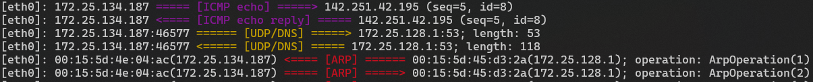

# Packet Flow

[](./LICENSE)
[](https://github.com/rmuraix/pf/actions/workflows/build.yml)  
Simple packet capture



## Installation

```shell
cargo install --git https://github.com/rmuraix/pf
```

## Usage

```shell
sudo pf -i <NETWORK INTERFACE>
```

```
Options:
  -i, --interface <NETWORK INTERFACE>  Name of the network interface
      --noudp                          Do not display UDP
      --no-color                       Disable ANSI colors in output (or set NO_COLOR)
  -h, --help                           Print help
  -V, --version                        Print version
```

## Requirements

`pf` captures with [libpcap](https://www.tcpdump.org/) (via the `pcap` crate)
and needs it at build time and, on Windows, at run time.

| OS | Build | Run |
| --- | --- | --- |
| Linux | `libpcap-dev` (Debian/Ubuntu), `libpcap-devel` (Fedora), `libpcap` (Arch) | `libpcap` shared library |
| macOS | Nothing (libpcap ships with macOS) | Nothing |
| Windows | [Npcap SDK](https://npcap.com/#download): add its `Lib\x64` (or `Lib\ARM64`) folder to the `LIB` environment variable | [Npcap](https://npcap.com/#download) installed (provides `wpcap.dll`) |

### Permissions

Live capture needs raw-capture privileges:

* **Linux**: run as root, or grant the binary capabilities instead:
  `sudo setcap cap_net_raw,cap_net_admin=eip $(which pf)`.
* **macOS**: run as root (`sudo pf ...`) or make `/dev/bpf*` readable for your user.
* **Windows**: run from an Administrator terminal, or allow non-admin capture
  when installing Npcap. On Windows the interface name is the Npcap device
  name, e.g. `\Device\NPF_{GUID}`.

### Supported link-layer types

Ethernet, raw IP (e.g. TUN), BSD/macOS/Npcap loopback, and Linux cooked capture
(v1 and v2, e.g. interface `any`). The type is read from libpcap; an interface
with any other type (e.g. 802.11 monitor mode, PPP) is rejected with an error.

### Notes

* Timestamps and lengths come from libpcap; frames are captured in full
  (snapshot length 65535).
* IP fragments are reported as unknown frames: the transport header is not
  reliably available.

## Contributing

Your contribution is always welcome. Please read [Contributing Guide](.github/CONTRIBUTING.md).
